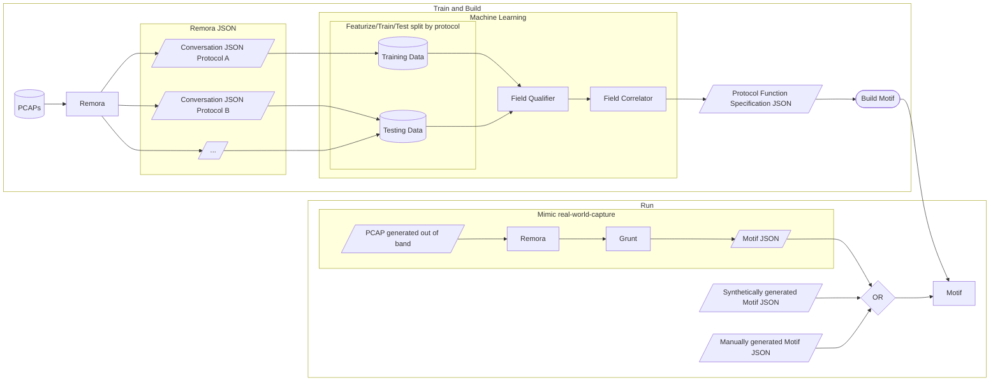

# End-to-end Demo Workflow

## Remora

A tool that takes in a PCAP and outputs one or many JSON files containing a list of conversations. There is one JSON file per protocol, e.g. on file for QUIC, one file for RTP. Each conversation contains a list of packets, and each packets contains a list of fields where each field has a name, value, size, and position.

### Conversation

A conversation in Remora is defined as all the communication between a given source and destination IP and port.

## Field Qualifier

A machine learning model trained to label protocol fields.

## Field Correlator

A tool for finding correlations between field values in an effort to find size and length fields. This is used to both refine the results of the field qualifier as well as to model the relationship between dependent fields so that generator functions can be automatically built into Motif.

## Motif

A tool to generically simulate network traffic of various protocols. The traffic is controlled from the client side via control messages embedded in the client-sent packets.

### Motif JSON

The input to Motif, a JSON list of packets where each packet has a direction and a list of fields. If a field is known, i.e. has been learned in the ML stage and can be automatically generated by Motif, then the field is labeled with its name and includes any arguments needed for generation, e.g. size. If a field is unknown then raw hex data can be provided.

## Grunt

A tool for converting Remora output into Motif input. Grunt will simplify the Motif input based on what fields have been learned in the machine learning stage, i.e. based on which fields Motif can automatically generate. Generally speaking, higher ML performance will results in a more compact Motif input.
